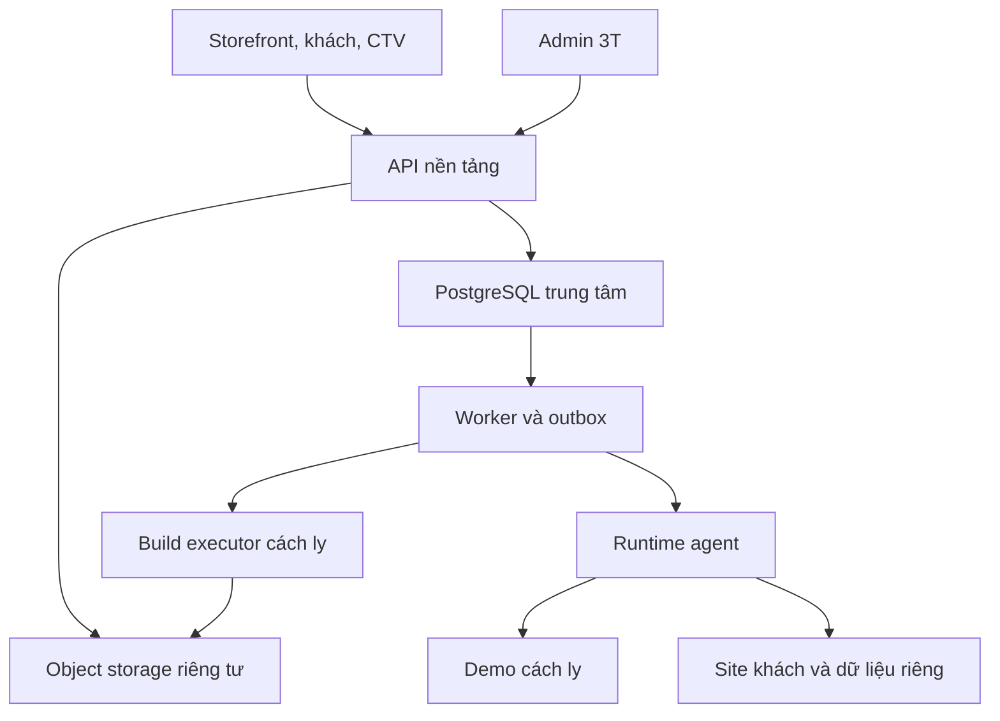

# 02. Kiến trúc, SQL và ranh giới dữ liệu

## 1. Kiến trúc đề xuất

Khởi đầu bằng **modular monolith**, tách process API và worker nhưng dùng chung các module nghiệp vụ. Không bắt buộc Kubernetes, Redis, microservice hay hàng loạt máy chủ ngay từ đầu. Build mã nguồn và chạy demo vẫn phải nằm trong vùng cách ly, không chạy cùng quyền với API thu tiền.

| Thành phần | Công nghệ mặc định đề xuất | Trách nhiệm |
|---|---|---|
| Storefront + portal | React/Next.js, TypeScript | Trang có SEO và các dashboard |
| API nền tảng | Node LTS + Fastify, TypeScript | Auth, catalog, order, entitlement, partner |
| SQL nền tảng | PostgreSQL | Giao dịch đồng thời, constraint, job/outbox |
| Worker nghiệp vụ | TypeScript, jobs lưu SQL | Provision, đối soát, expire, webhook |
| Build worker | Executor riêng, policy adapter | Build source không đáng tin cậy |
| Runtime tiêu chuẩn | Node HTTP + SQLite | Website nhỏ có CMS/API độc lập |
| Static runtime | HTTP static server | HTML/dist; không cần ép có SQL |
| Reverse proxy | Caddy, điều khiển qua agent nội bộ | Host routing và HTTPS |
| Artifact/media | Object storage riêng tư + signed URL | ZIP/source/build/backup/media |
| Hạ tầng ban đầu | VPS Linux + Docker Compose | Dev và staging; production theo phân vùng |

Đây là lựa chọn kiến trúc của dự án; dev chốt phiên bản còn được hỗ trợ tại mốc khởi tạo, ghi chính xác vào lockfile/toolchain. Không dùng tag `latest` cho release. PostgreSQL trung tâm được chọn vì nhiều tác vụ thanh toán, CTV và worker ghi đồng thời; SQLite dùng cho site nhỏ độc lập để khách dễ deploy. SQLite không phải database “kém cao cấp”; mỗi loại có mô hình vận hành khác nhau [S1].

## 2. Ba ranh giới dữ liệu

1. **Control plane:** tài khoản, giao dịch, quyền mua, catalog, CTV, jobs. Không giao database này trong bộ cài.
2. **Demo:** seed tổng hợp, account ngắn hạn, volume riêng theo phiên. Không mount dữ liệu production, không có khóa thanh toán/email thật.
3. **Site khách:** nội dung, tài khoản quản trị, media và cấu hình thuộc site. Hosting và self-host chạy cùng giao thức runtime; chỉ cấu hình triển khai khác.

Không cho client chọn database path. `site_id` phải được phân giải ở backend từ membership và route đã xác minh. Domain request đi qua registry ánh xạ canonical hostname → site_id → runtime, không nối trực tiếp Host header vào đường dẫn tệp hay truy vấn SQL.

Một SQLite file không đặt trên ổ chia sẻ giữa nhiều container writer. V1 một instance ứng dụng/site, file trên volume local bền vững, WAL/busy timeout được kiểm thử; backup dùng cơ chế nhất quán. Site cần nhiều writer/replica chuyển qua adapter PostgreSQL bằng migration riêng [S1].

## 3. Module và giao tiếp nội bộ

| Module | Sở hữu | Event đi ra |
|---|---|---|
| Identity | users/sessions/memberships | user.verified |
| Catalog | templates/versions/translations/plans | version.ready, template.published |
| Ingestion | imports/builds/artifacts | import.failed, artifact.ready |
| Commerce | quotes/orders/payments/refunds | order.paid, refund.settled |
| Entitlement | licenses/allocations/downloads | entitlement.activated |
| Hosting | sites/deployments/domains/backups | site.ready, site.failed |
| Partner | keys/attribution/commissions/payouts | commission.eligible |
| Notification | mail/webhook delivery | notification.failed |

Các module gọi service interface, không tùy tiện ghi bảng của nhau. Event ghi cùng transaction với thay đổi nghiệp vụ trong outbox. Worker xử lý ít nhất một lần; consumer phải dedupe. Không quảng cáo “exactly once” chỉ dựa trên queue.

## 4. Quy ước SQL

- ID không tuần tự dễ đoán: UUID; timestamp `timestamptz` lưu UTC. UI mặc định Asia/Ho_Chi_Minh, có tùy chọn người dùng.
- Tiền là integer minor units + ISO currency. VND exponent 0; không dùng float. Ngôn ngữ không quyết định currency.
- Cột tiền gửi API dạng chuỗi số nguyên để tránh mất độ chính xác JavaScript; phép tính dùng decimal/integer library phù hợp.
- `row_version` integer cho optimistic locking. Cập nhật gửi `If-Match`; xung đột trả 409 hoặc 412 theo hợp đồng đã chốt (mặc định 412).
- `created_at`, `updated_at`; bảng giao dịch không hard-delete. Soft delete dùng cho nội dung, không làm mất audit.
- JSONB chỉ cho snapshot/config linh hoạt; khóa tham chiếu, tiền, trạng thái phải có cột/ràng buộc rõ.
- Truy vấn có parameter; không nhận tên bảng/SQL từ trình duyệt. Sort/filter dùng allowlist.

## 5. Từ điển dữ liệu nền tảng

Ký hiệu: `*` bắt buộc; `FK` khóa ngoại; `UQ` unique. Các bảng sau là thiết kế logic đủ để viết migration; dev bổ sung index bằng kế hoạch truy vấn và đo tải, không tự bỏ constraint nghiệp vụ.

| Bảng | Cột chính | Constraint/index quan trọng |
|---|---|---|
| users | id*, email_normalized*, password_hash, verified_at, preferred_locale*, status* | UQ email_normalized; không lưu password thô |
| sessions | id*, user_id FK*, token_hash*, expires_at*, revoked_at | UQ token_hash; index user/expires |
| auth_tokens | id*, user_id FK*, purpose*, token_hash*, expires_at*, used_at | Một lần; revoke token cũ theo purpose |
| roles / permissions | id*, code* | UQ code |
| user_roles / role_permissions | FK hai chiều* | Composite PK |
| site_memberships | site_id FK*, user_id FK*, role*, status* | UQ site/user; không suy quyền từ CTV |
| templates | id*, slug*, owner_id FK*, status*, category_id FK, published_version_id FK | UQ slug; status/category index |
| template_categories | id*, code*, parent_id FK | UQ code; chống cycle |
| template_versions | id*, template_id FK*, semver*, manifest_json*, source_sha*, artifact_id FK, status*, schema_version* | UQ template/semver; immutable sau ready |
| template_translations | template_id FK*, locale*, title*, summary, description, slug*, seo_title, seo_description, status* | UQ template/locale và locale/slug |
| template_capabilities | version_id FK*, capability*, config_json | UQ version/capability |
| plans | id*, template_id FK*, code*, deployment_mode*, status*, limits_json* | UQ template/code; không đổi snapshot đơn cũ |
| plan_prices | id*, plan_id FK*, currency*, amount_minor*, interval*, effective_from*, effective_to | Không chồng khoảng hiệu lực cho cùng plan/currency/interval |
| quotes | id*, user_id FK nullable, partner_id FK nullable, snapshot_json*, expires_at*, signature_hash* | Quote bound to actor/session, không tin giá client |
| orders | id*, buyer_id FK nullable, checkout_session_id FK, status*, currency*, total_minor*, locale*, partner_id FK, terms_version*, paid_at | Index buyer/created, partner/created; buyer phải có trước fulfill |
| order_items | id*, order_id FK*, template_id FK*, version_id FK*, plan_id FK*, quantity*, unit_price_minor*, discount_minor*, tax_minor*, snapshot_json* | quantity v1=1; amount không âm |
| payment_attempts | id*, order_id FK*, provider*, provider_ref, amount_minor*, currency*, status*, settled_at | UQ provider/provider_ref nếu có |
| payment_events | id*, provider*, provider_event_id*, raw_body_hash*, verified_at, received_at*, processing_status* | UQ provider/provider_event_id; payload nhạy cảm giữ hạn |
| refunds | id*, payment_id FK*, amount_minor*, reason*, status*, provider_ref, requested_by FK | Tổng refund settled không vượt captured |
| entitlements | id*, order_item_id FK*, user_id FK*, mode*, status*, instance_limit*, updates_until, runtime_expires_at nullable | UQ order_item; selfhost perpetual runtime_expires_at null |
| entitlement_allocations | id*, entitlement_id FK*, site_id FK*, state* | UQ entitlement/site; allocate trong transaction khóa entitlement |
| download_events | id*, entitlement_id FK*, artifact_id FK*, user_id FK*, issued_at*, used_at, expires_at* | Token lưu hash; log không ghi signed URL |
| subscriptions | id*, site_id FK*, plan_id FK*, current_period_start*, current_period_end*, status*, policy_snapshot* | Một subscription đang hiệu lực/site |
| renewal_applications | order_item_id FK*, subscription_id FK*, period_start*, period_end* | UQ order_item ngăn cộng thời hạn lặp |
| sites | id*, owner_id FK*, template_version_id FK*, display_name*, status*, default_locale*, runtime_id, node_id, row_version* | Index owner/status; không xóa khi provision lỗi |
| deployments | id*, site_id FK*, artifact_id FK*, operation*, status*, previous_deployment_id FK, job_id FK | Một deployment chuyển đổi tại một thời điểm/site |
| domains | id*, site_id FK*, hostname_ascii*, status*, verification_token_hash, verified_at, is_primary*, cert_expires_at | UQ hostname đang sở hữu; một primary/site bằng partial unique |
| demo_sessions | id*, user_id FK nullable, version_id FK*, session_hash*, status*, expires_at*, runtime_id, promotion_lock_until | Index expires/status; không cleanup session được promotion lock |
| imports | id*, actor_id FK*, source_kind*, repo_id, commit_sha, subdir, object_key, digest*, detected_adapter, status*, errors_json | UQ idempotency scope; không lưu Git token ở đây |
| build_runs | id*, import_id FK*, attempt*, adapter_version*, status*, log_key, started_at, finished_at, artifact_id FK | UQ import/attempt |
| artifacts | id*, object_key*, sha256*, size_bytes*, media_type*, kind*, visibility*, retention_class* | UQ object_key; immutable digest |
| backups | id*, site_id FK*, object_key*, checksum*, schema_version*, status*, created_at*, expires_at | Chỉ succeeded được restore |
| jobs | id*, type*, payload_json*, dedupe_key*, status*, attempts*, next_run_at*, lease_until, fencing_token* | UQ dedupe_key; index status/next_run |
| outbox_events | id*, event_type*, aggregate_id*, payload_json*, created_at*, published_at | Index unpublished; consumers dedupe event id |
| idempotency_records | principal_scope*, route*, key*, request_hash*, response_json, status*, expires_at* | Composite UQ scope/route/key; body khác trả 409 |
| partner_accounts | id*, user_id FK*, code*, status*, policy_id FK, payout_profile_ref | UQ user, UQ code |
| partner_api_keys | id*, partner_id FK*, prefix*, key_hash*, scopes*, expires_at, revoked_at, last_used_at | UQ prefix; secret chỉ hiện một lần |
| checkout_sessions | id*, partner_id FK nullable, external_reference, quote_id FK*, status*, return_url, expires_at*, claim_hash | UQ partner/external_reference khi không null |
| attributions | id*, order_id FK*, partner_id FK*, source*, policy_snapshot*, recorded_at* | UQ order_id; chốt trước payment |
| commission_entries | id*, partner_id FK*, order_item_id FK*, source_event_id*, type*, amount_minor*, currency*, eligible_at, reversed_entry_id FK | UQ source_event/type/item; ledger append-only |
| payout_requests | id*, partner_id FK*, currency*, amount_minor*, status*, bank_profile_version*, approved_by FK | Reserve số dư atomically; tránh chi hai lần |
| payout_allocations | payout_id FK*, commission_entry_id FK*, amount_minor* | Ràng buộc không vượt eligible khả dụng |
| webhook_endpoints | id*, partner_id FK*, url*, secret_ref*, events*, status*, verified_at | URL kiểm tra public HTTPS; không cho SSRF |
| webhook_deliveries | id*, endpoint_id FK*, event_id*, attempt*, status*, next_try_at, response_code | UQ endpoint/event/attempt |
| translation_jobs | id*, resource_type*, resource_id*, locale*, status*, source_revision*, reviewed_by FK | Nội dung nguồn đổi → bản dịch stale |
| notifications | id*, user_id FK*, event_key*, locale*, channel*, status*, payload_ref | Dedupe event/user/channel |
| support_tickets / ticket_messages | id*, requester/site/assigned FK, status*, body*, attachments_ref | Phạm vi theo người gửi/phân công |
| audit_logs | id*, actor_type*, actor_id, action*, resource_type*, resource_id, trace_id*, created_at*, diff_redacted | Append-only; không chứa password/token/card |
| settings | key*, value_json*, revision*, updated_by FK | Secrets chỉ reference, không value |

Các bảng hỗ trợ UI/auth/CMS: `mfa_methods(user_id,type,encrypted_secret_ref,status)`, `mfa_recovery_codes(user_id,code_hash,used_at)`, `step_up_grants(session_id,scope,expires_at)`, `invitations(target_email_hash,inviter,role/site,token_hash,expires_at,accepted_at)`, `notification_preferences(user_id,event,channel,enabled)`; `platform_pages(id,slug,status,revision)` và `platform_page_translations(page_id,locale,title,body,seo,status,source_revision)`; `policy_versions(id,code,version,effective_at,body_hash)` và `policy_translations(policy_version_id,locale,body,review_status)`; `contact_requests(id,name,email,body,consent_version,spam_status,created_at)`; `commission_policies(id,revision,effective_at,rules_json)`; `payout_profiles(id,partner_id,revision,encrypted_details_ref,verified_at)`. Unique các khóa natural cùng scope, FK và audit như bảng chính; không dùng một bảng settings để nhét toàn bộ dữ liệu giao dịch.

## 6. Invariant bắt buộc bằng transaction/constraint

1. `order.total = sum(item.unit_price * quantity - discount + tax)` theo quote; không âm.
2. Số tiền settled và currency phải khớp nghĩa vụ thanh toán trước `paid`; thiếu/thừa vào hàng chờ đối soát.
3. `entitlement.order_item_id` duy nhất. Payment callback lặp không tạo entitlement lặp.
4. Reservation instance theo entitlement khóa hàng trước khi đếm; không kiểm quota bằng read rồi insert rời rạc.
5. Đơn CTV chưa có buyer được xác minh không được cấp tài khoản/site cho email do CTV tùy nhập.
6. Gia hạn lấy `max(current_period_end, settlement_effective_time)` theo chính sách và ghi `renewal_applications` cùng transaction.
7. `is_primary` domain chỉ khi domain active; khi suspend vẫn giữ reservation hostname để người khác không chiếm.
8. Không sửa artifact/version đã phát hành. Đổi source tạo version mới.
9. Refund/chargeback tạo bút toán đảo hoa hồng, không sửa entry lịch sử.
10. Payout reserve/approve/settle/failed phải trả hoặc chốt khoản giữ trong transaction.

## 7. Job đáng tin cậy

Claim job bằng transaction khóa hàng, lease có thời hạn, heartbeat và fencing token. Worker chết → job có thể được nhận lại; agent từ chối thao tác cũ với fencing token thấp. Retry exponential backoff có jitter, số lần hữu hạn, sau đó dead-letter/needs_attention. `provision:{site_id}:{deployment_id}` là dedupe key; không dùng mỗi lần retry một site mới.

Tác vụ ngoài DB không thể atomic với transaction SQL: dùng saga với checkpoint (reserved → volume_created → runtime_started → health_passed → route_enabled). Chỉ công bố route sau health; rollback bù từng tài nguyên theo ownership tag. Không xóa tài nguyên nếu không chứng minh do chính job đó tạo.

## 8. SQL website thành phẩm

| Nhóm | Bảng | Quy tắc |
|---|---|---|
| Identity | admin_users, sessions, roles | Cookie riêng origin/site; setup token một lần |
| Nội dung | pages, page_translations, blocks | Draft/published, revision, locale |
| Catalog | categories, category_translations, products, product_translations, product_media | Slug unique theo locale; public chỉ thấy published |
| Media | media, media_usage | Path nội bộ, MIME/size/checksum, alt theo locale |
| Điều hướng | menus, menu_items, menu_translations | Không cho menu trỏ tới script URL |
| Liên hệ | contact_requests | Consent version, spam status, retention |
| Cấu hình | site_settings, locale_settings, redirects | Tách secret và public setting |
| Vận hành | schema_migrations, audit_logs | Seed demo không chạy lại trên dữ liệu thật |

Commerce của website khách là capability tùy chọn `shop.*`, khác nghiệp vụ bán mẫu của nền tảng. Nếu mẫu chỉ giới thiệu sản phẩm, không hiện tồn kho/checkout giỏ hàng giả. Các mẫu fullstack khác framework phải có admin riêng và adapter contract; import không tự sinh CMS cho mọi source.

## 9. Khả năng mở rộng

Theo dõi p95 API, pool DB, queue age, CPU/RAM/disk từng node, lỗi SQLite busy và số website. Khi vượt ngân sách đo được: thêm worker/node, tách build, cache public catalog theo locale; sau đó mới cân nhắc queue chuyên dụng. Runtime node placement phải tính tài nguyên đặt trước và quota, không đưa số site cố định như cam kết thương mại.

## 10. Nguồn

[S1] SQLite — [Appropriate Uses For SQLite](https://sqlite.org/whentouse.html), kiểm tra 23/10/2026. Khuyến nghị database trung tâm và cơ chế tenant ở trên là quyết định thiết kế của dự án, không phải trích nguyên văn tài liệu SQLite.
