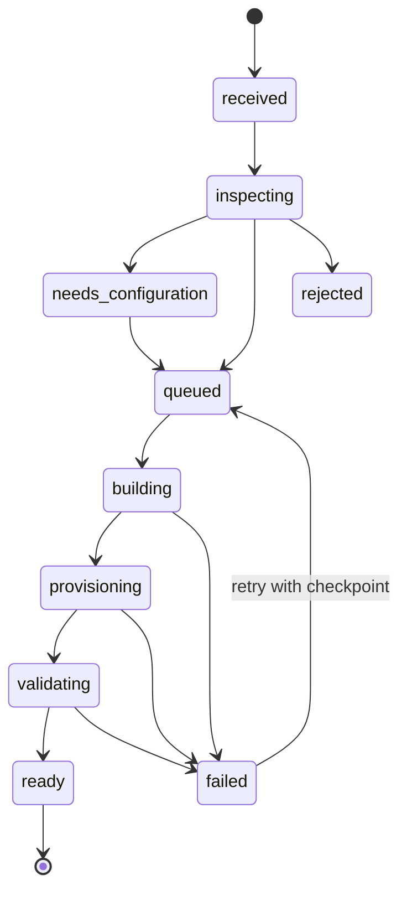

# 03. Đưa tài nguyên lên, nhận diện và chạy demo tự động

## 1. Hợp đồng sản phẩm

Mục tiêu sử dụng: **đưa gói chuẩn lên một lần → nhận URL demo tự động**, không phải mỗi mẫu lại viết một bộ quy trình deploy mới. “Tài nguyên” bao gồm source/static build, asset được cấp quyền, manifest, seed và tài liệu. Chỉ có hình ảnh hoặc SQL chưa đủ để chạy website.

Mọi bản import giữ nguyên source gốc dưới digest. Các thay đổi do hệ thống chuẩn hóa nằm trong build workspace và manifest hiệu lực được lưu riêng; không âm thầm ghi đè repo nguồn.

## 2. Ma trận hỗ trợ

| Đầu vào | Cách nhận diện | Cấu hình cần có | Kết quả v1 |
|---|---|---|---|
| HTML/CSS/JS đã build | Có `index.html` và asset hợp lệ | root/index, SPA fallback nếu có | Hỗ trợ tự động |
| Vite React/Vue static | package.json có dependency Vite và lockfile | build script, outputDir, toolchain | Hỗ trợ qua `vite-static` |
| Next.js static export | Có bản `out/` hoàn chỉnh | Nhập `out` bằng static-html | Hỗ trợ bản đã export |
| Next.js server | Manifest `next-standalone` | standalone output, start/health, env/schema | Hỗ trợ khi đáp ứng adapter |
| Node HTTP chuẩn | Manifest `node-http` | build/start/port/health + migration/seed | Hỗ trợ khi đáp ứng adapter |
| Có Dockerfile bất kỳ | Chỉ nhận diện có container recipe | Chuyển thành adapter do 3T duyệt | Không tự chạy Dockerfile lạ |
| PHP/Laravel/WordPress/Python | Nhận diện để báo đúng | Adapter riêng và DB profile | Trạng thái unsupported, không đoán chạy |
| Chỉ ảnh/Figma/PDF/SQL dump | Không có executable entry | Cần source được dev xây | Không tạo demo giả |
| URL website đang online | Không có source sở hữu | Có thể lưu liên kết tham khảo | Không scrape thành bộ cài để bán |

Hỗ trợ bốn adapter là tiêu chí mục tiêu của bản 1.0; có thể hoàn thành static và Node chuẩn trước, nhưng phải ghi rõ adapter nào chưa triển khai trong UI. `unsupported` khác `build_failed`.

## 3. Cấu trúc gói

| Đường dẫn | Bắt buộc | Nội dung |
|---|---|---|
| `template.manifest.json` | Có, trừ static auto-detect | Metadata và contract runtime |
| `site/` hoặc source root | Có | HTML/dist hoặc mã nguồn |
| lockfile | Có khi build dependency | Chỉ một package manager tại root build |
| `README.md` | Có trước khi bán | Hướng dẫn sử dụng/triển khai |
| `LICENSE-ASSETS.md` | Có trước khi bán | Nguồn và quyền phân phối ảnh/font/code |
| `screenshots/` | Tùy chọn | Ảnh có sẵn; thiếu thì hệ thống chụp |
| `migrations/` | Với DB | Migration có version, forward/backward policy |
| `seeds/` | Khi có demo dữ liệu | Dữ liệu tổng hợp, không phải dữ liệu khách thật |
| `.env.example` | Với env | Tên biến, ví dụ vô hại, không secret |
| `locales/` | Khi runtime có i18n | Gói UI hoặc dữ liệu locale |

ZIP có đúng một thư mục bao ngoài được strip một lần nếu bên trong là project root duy nhất. Nhiều project root → yêu cầu chọn thư mục, không lấy cái đầu tiên. `.DS_Store`/`__MACOSX` bỏ khỏi workspace build; source archive vẫn được giữ nguyên theo chính sách.

## 4. Manifest chuẩn

Schema chính thức nằm ở `contracts/template-manifest.schema.json`. Mẫu HTML nhỏ nằm ở `examples/static-landing/`. Các manifest `contracts/examples/` là ví dụ cấu trúc, không phải app fullstack đã được cung cấp.

| Trường | Ý nghĩa | Ràng buộc |
|---|---|---|
| schemaVersion | Phiên bản contract | V1 chỉ chấp nhận 1 |
| slug / version | Mã mẫu / phiên bản phát hành | Slug chuẩn; SemVer; không ghi đè cùng version khác digest |
| name / summary | Metadata theo locale | Phải có default locale |
| adapter | Cách build/chạy | static-html, vite-static, next-standalone, node-http |
| projectRoot | Root trong gói/repo | Relative, không `..`, không symlink |
| build | Preset/toolchain/outputDir/script | Static không build; source có lockfile |
| runtime | static entry hoặc port/start/health | argv, không shell string |
| database | none/sqlite/postgres + migrate/seed argv | Không để DSN/credential thật |
| demo | Chế độ, TTL, seed profile | publicReadonly hoặc isolatedAdmin |
| locales | default/supported/contentMode | Không tuyên bố locale chưa có nội dung |
| capabilities | Chức năng và admin route | UI chỉ hiển thị capability đã khai báo và kiểm tra |
| env | Khai báo biến cần nhập | Scope public/server; secret không có defaultValue |
| export | Các mode và đường dẫn source | Chỉ đường dẫn được duyệt; không chứa dữ liệu thật |

Giá/hoa hồng/giới hạn tài nguyên cuối cùng không do manifest tự quyết. Manifest đề nghị yêu cầu; policy của nền tảng là giới hạn tối đa. Tệp manifest không được chỉ định privileged, host network, mount arbitrary host path hoặc Docker socket.

### 4.1 Nhận diện khi thiếu manifest

1. Chỉ đọc cấu trúc, package metadata và tệp text có giới hạn, chưa thực thi script.
2. Có HTML thuần và không thấy dấu hiệu source framework → candidate static confidence cao.
3. Có package.json → kiểm dependency + script + lockfile. HTML ở project Vite không được hiểu nhầm là dist deploy được.
4. Không import/execute JS config để “đọc” framework; config có thể thực thi code. Các trường cần runtime introspection chỉ đọc trong sandbox.
5. Có nhiều framework hoặc thiếu lockfile/entry → `needs_configuration`; hiển thị các lựa chọn, không tự đoán.
6. Sinh `effective_manifest`, hiển thị diff/cấu hình. Với static rõ ràng, policy admin cho phép auto-continue; các source khác chỉ auto khi adapter/profile đã tin cậy và đủ trường.
7. Lưu adapter version + toolchain + input digest để build lại có thể truy vết.

### 4.2 Quy ước build từng adapter

- `static-html`: không cài dependency; chỉ serve thư mục đã kiểm tra, disable listing, no directory escape.
- `vite-static`: install khóa dependency trong sandbox, build bằng script được chọn, lấy outputDir mặc định `dist`; serve bằng static server. Không dùng `vite dev` hoặc `vite preview` làm production server [S2].
- `next-standalone`: build output standalone, đóng gói server và tệp cần thiết; bổ sung `public` và `.next/static` đúng cấu trúc vì output standalone không tự chép cả hai [S3]. Healthcheck không phụ thuộc login.
- `node-http`: build theo profile, chạy argv trong runtime Node hỗ trợ, bind `0.0.0.0:$PORT`; health endpoint, shutdown signal và persistent path rõ.
- Tất cả: không dùng `eval`, `sh -c` với chuỗi manifest; argv vẫn là code không tin cậy và phải cách ly. Lockfile cùng commit; build cache không chia sẻ secret hoặc writable cache giữa tenant.

## 5. Pipeline nhập

| Bước | Công việc | Điều kiện qua / mã lỗi |
|---|---|---|
| 1. Authorize | Quyền template:import, quota | 403 / quota_exceeded |
| 2. Receive | Upload có checksum hoặc fetch commit GitHub | source_unavailable |
| 3. Quarantine | Lưu vùng riêng, chưa public | artifact_store_error |
| 4. Inspect archive | Path, size, file count, type | archive_unsafe / archive_too_large |
| 5. Resolve root | Một root rõ ràng | project_root_ambiguous |
| 6. Secret scan | Chặn .env/key/credential nghi ngờ | secret_detected; không in giá trị |
| 7. Detect | Chọn adapter + version | adapter_unsupported |
| 8. Validate manifest | Schema + cross-field + file existence | manifest_invalid |
| 9. Policy | Toolchain, license, env, network | policy_denied / needs_configuration |
| 10. Build | Executor hạn tài nguyên/thời gian | install_failed / build_failed / build_timeout |
| 11. Inspect output | Entry/assets, size, SBOM, malware | artifact_invalid |
| 12. Provision preview | Mạng/volume/runtime riêng | provision_failed |
| 13. Init DB | Migration trước, seed demo sau | migration_failed / seed_failed |
| 14. Health | HTTP + dependency readiness | health_failed |
| 15. Browser smoke | Trang chính, deep link, API, console | smoke_failed |
| 16. Screenshots | Desktop/mobile đúng locale | screenshot_failed (có thể retry độc lập) |
| 17. Record | Immutable artifact + manifest + logs | persistence_failed |
| 18. Ready | URL preview và draft catalog | preview_ready |

Upload xong trả import_id/job_id ngay; UI poll có backoff hoặc SSE. Đóng tab không hủy job. Retry chỉ bước thất bại nếu input/checkpoint còn hợp lệ, không xóa source. Cancel dừng graceful, quarantine/dọn tài nguyên do job tạo; không đụng site production.

## 6. An toàn gói nhập và sandbox

Đây là yêu cầu trực tiếp của chức năng nhận và chạy source, không thể thay bằng kiểm đuôi ZIP.

- Chống Zip Slip: chuẩn hóa path theo cả POSIX/Windows, từ chối absolute, `..`, drive letter, symlink/hardlink, tên va chạm sau normalize. Extraction kiểm đường dẫn thực nằm trong root.
- Giới hạn tổng bytes **sau giải nén**, mỗi tệp, file count, compression ratio; không chỉ kiểm Content-Length. Chặn archive lồng vô hạn, device file, executable không thuộc preset.
- Không đưa .git history, `.env`, private key hoặc DB production vào artifact công khai/bộ tải khách.
- Build worker không có credential production, không mount docker.sock, không dùng privileged, filesystem tối thiểu, quota CPU/RAM/PID/time. Rootless giảm quyền nhưng không là sandbox tuyệt đối [S4]. Code chưa duyệt phải chạy executor/VM riêng; không đặt cạnh database thu tiền.
- Network build chỉ mở proxy dependency allowlist theo policy; runtime demo mặc định offline/restricted, chặn private/link-local/metadata/localhost của host, IPv6 nội bộ và DNS rebinding.
- Không tạo outbound email/SMS/payment thật. Demo adapter trả kết quả mô phỏng, có nhãn rõ.
- HTML/JS demo là mã không tin cậy: origin demo trên **domain gốc khác** với portal, cookie portal host-only và HttpOnly/Secure. Không chia sẻ domain cookie rộng.
- Iframe sandbox chỉ capability cần thiết; `postMessage` kiểm origin cụ thể + message schema. Không truyền token platform vào iframe, query string hay localStorage demo.
- Source và log đầu vào được xem là dữ liệu, không là chỉ dẫn cho worker/AI/operator để lấy secrets.

OWASP nêu kiểm loại tệp, tên tệp, kích thước và vị trí lưu là các lớp kiểm upload cần phối hợp [S5]. Các policy sandbox cụ thể trên là yêu cầu kiến trúc của dự án.

## 7. Demo giao diện và demo quản trị

| Mode | URL/identity | Quyền và vòng đời |
|---|---|---|
| Public readonly | Phiên bản catalog, immutable | Xem dữ liệu mẫu; form/checkout mô phỏng, không sửa DB dùng chung |
| Isolated admin | Session UUID ngẫu nhiên, cookie phiên riêng | Dữ liệu riêng, TTL 24h mặc định, quota, reset/cancel |

Demo public có thể là snapshot/static hoặc runtime read-only. Nếu muốn khách thử hành động ghi, tự tạo phiên riêng; không mở tài khoản admin dùng chung cho cả khách.

Admin session chỉ cấp sau rate-limit và (mặc định) đăng nhập xác minh. Một token exchange dùng một lần, TTL 60 giây, audience runtime cụ thể; exchange ở backend thành cookie runtime. Redact token trong log, `Referrer-Policy: no-referrer`, xóa query token sau exchange nếu dùng redirect. Tốt hơn dùng form POST/one-time relay thay token URL.

UI hiển thị “Dữ liệu dùng thử • Còn 23 giờ • Mua mẫu này”. Countdown dựa `expires_at` server; khi hết hạn API từ chối ghi dù UI đồng hồ sai. Scheduler thu hồi route/session, dừng runtime, xóa volume theo grace cleanup, ghi audit.

## 8. Giữ dữ liệu demo khi mua

Cho chọn “Dùng dữ liệu mẫu mới” hoặc “Giữ nội dung tôi vừa thử” nếu adapter hỗ trợ export nội dung. Không copy session, password demo, API keys, fake orders hay trạng thái thanh toán demo.

Promotion: khóa session chống cleanup có TTL hữu hạn → export nội dung whitelist + media → tạo site/DB mới → import và tạo admin thật → healthcheck → chuyển route → nhả khóa. Demo không biến trực tiếp thành production cùng volume. Nếu thất bại, giữ entitlement, retry với promotion snapshot; UI báo dữ liệu nào có thể giữ.

## 9. GitHub nguồn và cập nhật tự động

Nguồn do 3T quản lý, GitHub App đọc đúng repository đã chọn. Chọn branch/tag để theo dõi, nhưng mỗi import ghim commit SHA bất biến. Webhook `push` xác minh chữ ký và dedupe delivery ID; chỉ chạy path filter cho thư mục mẫu. PR từ fork không được nhận secrets hoặc auto production.

Mặc định commit mới → preview version mới, không tự phát hành bán và không tự update site khách. Admin có thể bật auto-preview cho source trusted; auto-publish phải cấu hình riêng với gates QA, license, giá và translation. Revoke GitHub integration chỉ chặn import sau, không xóa artifact đã bán.

## 10. Phát hành và xuất bộ cài

Trước publish phải đủ: demo health/smoke, default locale, quyền tài nguyên, giá/gói, khả năng export từng mode, README setup, phiên bản SQL, checksum. Source bundle được sinh từ file whitelist trong commit đã build; không từ thư mục runtime live.

Bundle self-host: source + lockfile + build recipe + migration + seed khởi tạo sạch + `.env.example` + compose/profile + healthcheck + setup + backup/restore guide + manifest + checksums + license thông báo. File thật được sinh khi pipeline production được triển khai; fixture trong bộ tài liệu này chỉ phục vụ kiểm tra contract.

Static không có admin không được quảng cáo có CMS. Mẫu có backend riêng không tương thích runtime tiêu chuẩn vẫn có thể bán sau khi adapter được tích hợp và kiểm thử; trạng thái UI phải thể hiện chính xác.

## 11. Chỉ tiêu kiểm thử đề xuất

Trên môi trường đo được ở tài liệu 10: gói HTML fixture dưới 1 MiB có demo trong 60 giây p95; source build có timeout 10 phút, báo đúng bước đang chờ. Đây là mục tiêu kiểm thử, không phải cam kết tất cả framework build dưới 60 giây. Queue dài phải trả ETA dựa queue, không đồng hồ giả.

## 12. Nguồn

- [S2 — Vite static deployment](https://vite.dev/guide/static-deploy.html).
- [S3 — Next.js output/standalone](https://nextjs.org/docs/app/api-reference/config/next-config-js/output).
- [S4 — Docker rootless](https://docs.docker.com/engine/security/rootless/).
- [S5 — OWASP file upload](https://cheatsheetseries.owasp.org/cheatsheets/File_Upload_Cheat_Sheet.html).

Kiểm tra các nguồn ngày 23/10/2026; adapter phải pin phiên bản đã kiểm thử thực tế.
