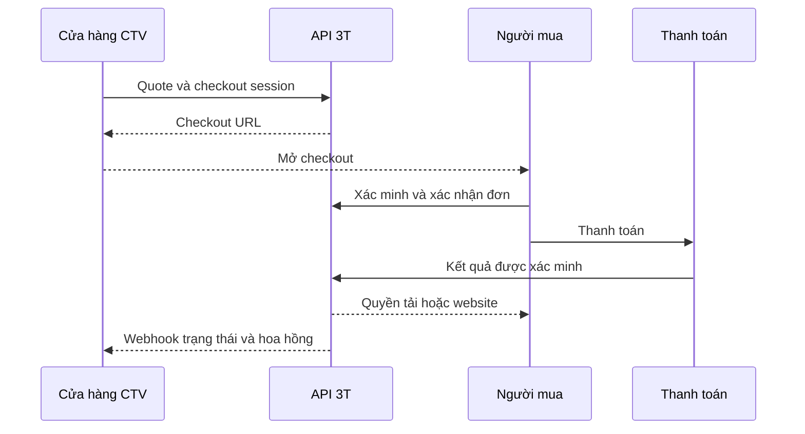

# 06. Cộng tác viên, API bán hàng và hoa hồng

## 1. Mô hình được chọn

CTV được phép **lấy dữ liệu mẫu qua API để trưng bày trên website của họ**, tạo liên kết demo, chuyển khách tới checkout và theo dõi đơn phát sinh. Nền tảng 3T xác nhận tiền và cấp quyền cho người mua; CTV nhận hoa hồng. Đây là chức năng bắt buộc của release hoàn chỉnh.

Không yêu cầu CTV phải mua mỗi mẫu mới được giới thiệu. Tuy nhiên API catalog/demo không cấp source hoặc quyền sử dụng thương mại của mẫu. Mua source riêng vẫn theo checkout và entitlement như người dùng khác.

| Hình thức | Bản 1.0 | Cách vận hành |
|---|---|---|
| Link giới thiệu | Có | URL ký/partner code, chọn mẫu và locale |
| Cửa hàng CTV qua API | Có | Backend CTV đọc catalog/giá, tạo checkout session |
| Nhúng demo | Có, theo policy | Iframe origin riêng hoặc link, không mật khẩu admin dùng chung |
| Giá do CTV tự đặt/thu riêng | Chưa | Cần mô hình reseller/credit/đối soát riêng |
| CTV quản trị site thay khách | Tùy quyền khách mời | Membership và audit, không suy từ attribution |
| CTV tải source mọi mẫu | Không | Chỉ entitlement mua riêng |

## 2. Đăng ký và kiểm duyệt

Verified user → gửi hồ sơ kênh bán/domain → pending → nhân sự có quyền duyệt → active → tạo keys. Trạng thái rejected có lý do và sửa gửi lại. Suspended ngăn tạo checkout mới và key hoạt động, nhưng không xóa order, hoa hồng hoặc site khách đã mua. Payout đang xử lý đi vào review, không tự đánh dấu mất quyền số dư.

Thông tin tối thiểu: display name, account owner, domain/channel, contact đã xác minh, locale/timezone, accepted partner terms version. Payout profile tách khỏi public partner profile; che thông tin tài khoản trong UI/log.

## 3. Luồng tích hợp end-to-end

1. CTV tạo key scope tối thiểu `catalog:read demo:link checkout:create orders:read`.
2. Backend CTV gọi catalog có `locale`, cache theo ETag và giới hạn (đề xuất 5 phút); giá có `price_revision`.
3. Khách chọn mẫu/gói; backend tạo quote mới, không dùng giá cache để thu tiền.
4. Tạo checkout session với `quote_id`, `external_reference`, `return_url`, locale. Key xác định partner; body không được tự đặt `partner_id`.
5. Trả `checkout_url`, `expires_at`, session id. Redirect khách tới nền tảng.
6. Buyer đăng nhập/xác minh, nhìn rõ mẫu/gói/giá và CTV giới thiệu; claim session bằng token đúng phiên.
7. Buyer thanh toán; 3T xác minh server-side, tạo entitlement cho buyer.
8. CTV nhận `order.paid`, sau đó `fulfillment.ready` hoặc `fulfillment.failed`. Webhook không kèm mật khẩu hay link source.
9. CTV gọi GET order để đồng bộ trạng thái cuối, chống event đến sai thứ tự.
10. Sau settlement và thời gian giữ, hoa hồng đủ điều kiện; CTV yêu cầu chi trả.



## 4. Hợp đồng request/response

Ví dụ minh họa; IDs và domain `.example` không phải tài khoản thật.

```http
POST /partner/v1/checkout-sessions
Authorization: Bearer <PARTNER_KEY_ON_SERVER>
Idempotency-Key: 89e03c5e-357f-4afd-a88c-213fe8bd6827
Content-Type: application/json
```

```json
{
  "quote_id": "quote_example",
  "external_reference": "CTV-ORDER-0001",
  "locale": "vi",
  "return_url": "https://partner.example/order-result",
  "campaign": "launch-october"
}
```

```json
{
  "data": {
    "id": "checkout_example",
    "checkout_url": "https://market.example/vi/checkout/checkout_example",
    "expires_at": "2026-10-23T12:00:00Z",
    "status": "awaiting_buyer"
  }
}
```

Không nhận `is_paid`, `final_price`, `commission_amount`, `download_url`, `admin_password` từ CTV. Nếu CTV muốn nhập email để tiện checkout, chỉ coi là hint và không lộ tài khoản có tồn tại; quyền vẫn chờ chính người mua xác minh. V1 mặc định không yêu cầu email người mua trong API partner để giảm dữ liệu thừa.

Session TTL đề xuất 30 phút; quote 15 phút. Session hết quote trước khi buyer chấp nhận thì re-quote và hiển thị giá mới để buyer xác nhận. Đã lập order với payment window thì khóa snapshot đến hạn đơn. Hai khóa external_reference và Idempotency-Key cùng chặn tạo đơn lặp khi CTV retry.

## 5. Scope, rate limit và khóa

| Scope | Cho phép | Không cho phép |
|---|---|---|
| catalog:read | Danh mục/giá được phép bán, localized metadata | Artifact private, secret manifest |
| demo:link | Link demo/referral được ký | Truy cập admin demo của người khác |
| checkout:create | Quote/session cho partner hiện tại | Ghi nhận thanh toán |
| orders:read | Đơn của đúng partner, dữ liệu tối thiểu | Buyer PII toàn bộ, đơn partner khác |
| commissions:read | Ledger/balance partner | Chỉnh sửa hoa hồng |
| events:read | Event gửi cho chính partner | Webhook event nội bộ |

Key secret sinh ngẫu nhiên đủ entropy, hash ở SQL, prefix cho tra cứu; UI hiện secret đúng một lần. Compare constant time. Scope/expiry/partner active kiểm **mỗi lần gọi**; revoke có hiệu lực ngay hoặc cache revoke tối đa 60 giây theo SLO. Có log key id và request id, không bearer value. Rotate có thể chồng tối đa 24h theo cấu hình; key cũ thu hồi sau khi kiểm key mới.

Mặc định đề xuất: catalog 120 request/phút/key, mutation 30/phút/key, demo theo quota riêng; thêm quota account và IP để key mới không lách. Trả 429/Retry-After. Sandbox và production có key/DB/events riêng. Request ID giúp hỗ trợ, không phải bí mật xác thực.

CORS không bảo vệ secret đã lộ. Hướng dẫn CTV dùng backend proxy. Nếu bổ sung publishable key cho catalog, chỉ đọc dữ liệu public với quota, không cấp checkout/write bằng loại key đó. Allowlist return URLs normalize scheme/host/path, không wildcard subdomain hoặc redirect tới URL tùy ý.

## 6. Attribution

Mặc định ưu tiên **partner trên checkout session hợp lệ**. Với link affiliate không có session, cookie first-party trên nền tảng ghi partner hợp lệ, TTL đề xuất 30 ngày và last eligible referral theo policy. Nếu cookie bị chặn, không cam kết attribution tuyệt đối; session API là cách rõ nhất. Tránh dựa cross-site third-party cookie.

Chốt partner attribution ở lúc tạo đơn; buyer được nhìn thấy đơn vị giới thiệu. Sau khi paid không cho CTV đổi partner của đơn. Tranh chấp attribution chỉ staff có quyền xử lý bằng event điều chỉnh và audit. Chặn self-referral bằng user identity khi policy yêu cầu; fingerprint/IP chỉ tín hiệu review, không tự kết luận gian lận từ một IP dùng chung.

Đơn mới và renewal có policy commission riêng. Mặc định renewal không hoa hồng nếu plan chưa cấu hình. Chính sách snapshot ở order item bảo vệ lịch sử khi sau này đổi rate.

## 7. Sổ hoa hồng

`commission_base = phần giá được tính hoa hồng sau discount và trước thuế`, tính theo từng order item. Hosting phí mẫu, phí khởi tạo, phí kỳ đầu và renewal được tách component để policy chọn phần áp dụng. Tỷ lệ integer basis points: 1000 = 10%; không float.

`commission = floor(base_minor × rate_bps / 10000)` cho VND theo quy tắc làm tròn v1. Lưu base/rate/rounding/policy version tại thời điểm ghi. Ví dụ minh họa: base 1.000.000đ, rate 1.000 bps → 100.000đ; không phải mức hoa hồng được chốt kinh doanh.

| Trạng thái/loại entry | Trigger | Số dư |
|---|---|---|
| accrued_pending | Payment settled, order attributed | Chờ đủ điều kiện |
| eligible | Hết hold, không dispute, fulfillment đủ điều kiện theo policy | Khả dụng |
| reserved | Tạo payout request hợp lệ | Chuyển từ khả dụng sang đang chi |
| paid | Tiền chi được đối soát | Tích lũy đã chi |
| reversal | Refund/chargeback settled | Bút toán âm liên kết entry gốc |
| adjustment | Điều chỉnh staff có lý do | Bút toán riêng, không sửa lịch sử |

Ledger append-only; trạng thái payout không được dùng thay sổ tiền. Nên có journal events và bảng projection balance có thể rebuild/đối chiếu từ ledger.

Hoàn một phần: phân bổ refund tới component/order item theo snapshot, tính commission còn được hưởng; reversal cộng dồn = commission gốc − commission hợp lệ còn lại, trừ các reversal đã ghi, tránh lệch rounding khi hoàn nhiều lần. Full refund → tổng hoa hồng net bằng 0.

Đã chi rồi mới refund: ghi balance âm/hold cho khoản sau hoặc xử lý theo thỏa thuận; không xóa payout đã trả. Mỗi currency một balance. Đối soát kiểm: accrued − reversals − paid − reserved = net available + pending theo trạng thái hold.

## 8. Payout

Partner nhập số tiền ≤ eligible available và đủ ngưỡng cấu hình → reserve atomic → requested → approved → processing → paid/failed. Approver không thể lấy cùng khoản cho hai payout. Chuyển khoản thủ công chỉ `paid` sau có reference/evidence và người có quyền đối soát; hệ thống không tạo nút giả “chuyển tiền thành công”. Failed giải phóng reservation đúng một lần.

Thay payout profile cần step-up, xác minh và lưu revision. Payout đã tạo dùng snapshot profile để không âm thầm chuyển đích. Thông báo thay đổi cho chủ tài khoản; dữ liệu ngân hàng được mã hóa và masked. Thuế/hóa đơn/điều khoản CTV là cấu hình và nội dung doanh nghiệp cần xác nhận trước kinh doanh thực tế; tài liệu không ấn định một mức thuế pháp lý.

## 9. Webhook CTV

Events: `order.created`, `order.paid`, `order.cancelled`, `fulfillment.ready`, `fulfillment.failed`, `refund.settled`, `commission.eligible`, `commission.reversed`, `payout.paid`, `payout.failed`. Chỉ sự kiện liên quan partner.

```json
{
  "id": "evt_example",
  "type": "order.paid",
  "created_at": "2026-10-23T10:00:00Z",
  "api_version": "v1",
  "resource_revision": 3,
  "data": {
    "order_id": "order_example",
    "external_reference": "CTV-ORDER-0001",
    "payment_status": "paid",
    "fulfillment_status": "queued",
    "amount_minor": "1500000",
    "currency": "VND"
  }
}
```

Headers: `X-3T-Event-Id`, `X-3T-Timestamp` Unix seconds, `X-3T-Signature: v1=<hex>`. Chuỗi ký = timestamp + dấu chấm + raw body bytes, HMAC-SHA256 bằng endpoint secret. Receiver kiểm signature constant time, timestamp lệch tối đa 5 phút và dedupe event ID. Mỗi retry/replay ký timestamp mới nhưng event ID cũ.

Delivery at-least-once; 2xx xác nhận, retry đề xuất 1 phút/5 phút/30 phút/2 giờ/12 giờ/24 giờ rồi dead-letter. Receiver lưu durable trước trả 2xx. Không theo HTTP redirect tới domain khác. Endpoint phải public HTTPS, DNS/IP kiểm khi đăng ký và từng lần gửi, chặn nội bộ/metadata và DNS rebinding; response body log giới hạn/redacted. Payload là machine data, không HTML lệnh.

## 10. Acceptance trọng yếu

- CTV A không GET đơn/key/webhook của B bằng đổi ID.
- Body chỉnh tiền/is_paid không mở quyền.
- Checkout API hoàn tất payment cấp entitlement cho buyer đã xác minh, không cho partner.
- Retry cùng external reference không tạo double payment/order.
- Key revoke/suspend chặn tạo đơn mới nhưng site đã mua vẫn chạy theo subscription.
- Refund một phần/full và sau payout đều đối soát được net commission.
- CTV chọn `en`, buyer checkout/email/portal có locale đúng; price currency vẫn VND nếu chưa mở tiền khác.
